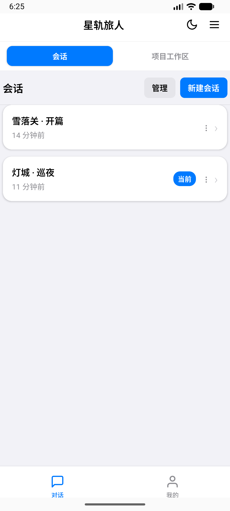
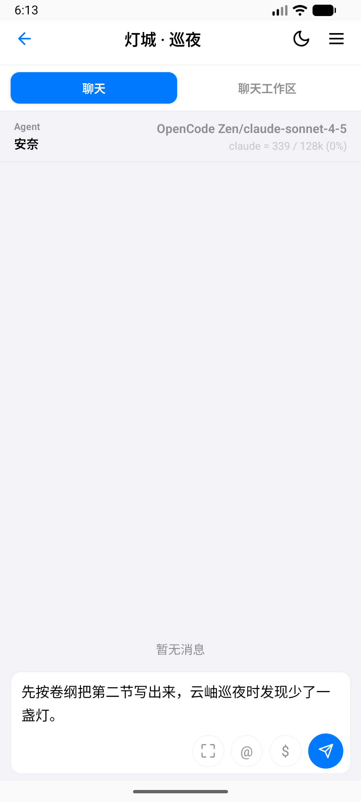
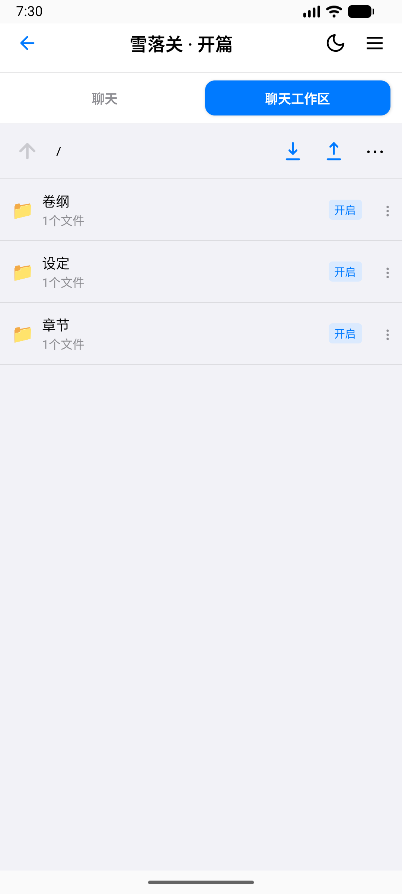
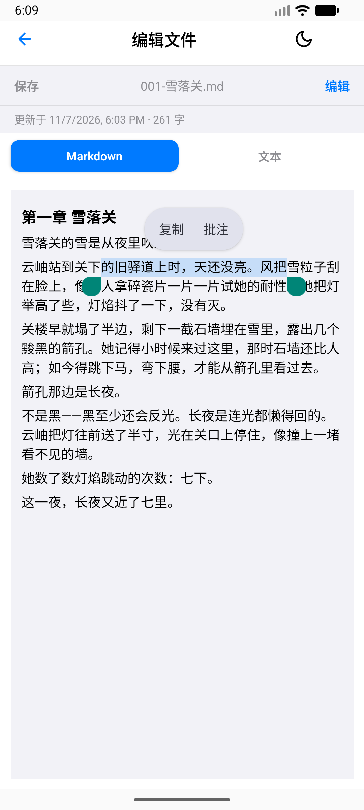
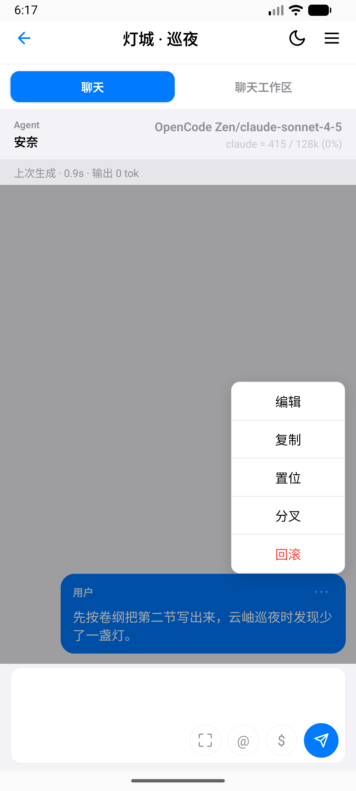
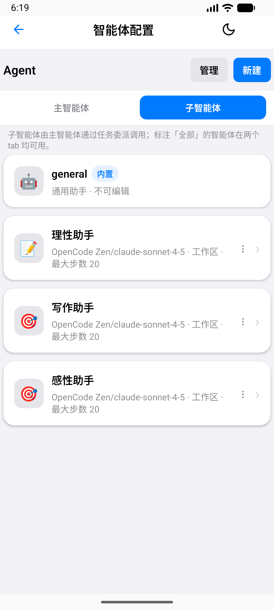
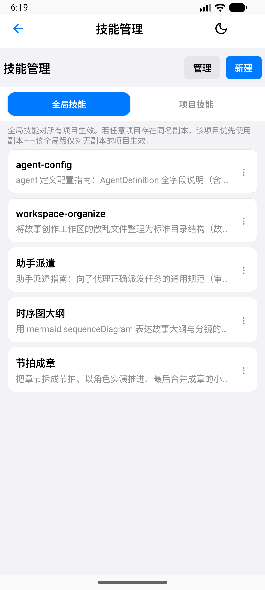
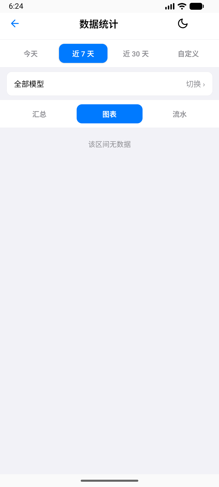
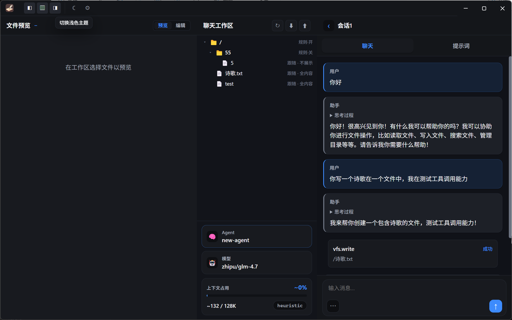

  

<h1 align="center">Novel Master</h1>

专注<strong>长篇小说创作</strong>的 AI Agent 工作台

  
  
  

<table align="center">
  <tr>
    <td align="center" width="24%">
      
       
      首页 · 项目与会话总览
    </td>
    <td align="center" width="24%">
      
       
      对话 · 聊天面板与输入框
    </td>
    <td align="center" width="24%">
      
       
      工作区 · 会话文件树
    </td>
    <td align="center" width="24%">
      
       
      批注 · 划词写意见，随消息定点改稿
    </td>
  </tr>
  <tr>
    <td align="center" width="24%">
      
       
      消息菜单 · 编辑、复制、置位、分叉、回滚
    </td>
    <td align="center" width="24%">
      
       
      智能体 · 子智能体列表
    </td>
    <td align="center" width="24%">
      
       
      技能 · 技能管理列表
    </td>
    <td align="center" width="24%">
      
       
      统计 · 数据统计页（图表 / 汇总 / 流水）
    </td>
  </tr>
</table>

世界观、人设、卷纲、章节放在同一棵虚拟文件树里，Agent 直接读写这些文件，不用把内容复制粘贴进对话框。写正文和改稿都在这一个工作区完成，你说哪一章的哪句话不对，它就去改那句话。至于上下文里放什么、每个文件露多少、谁排在前头，由你定。

## ✨ 亮点

- 🎛️ **上下文你说了算**：目录级规则给每个文件定展示档位（全文 / 头部 / 仅文件名）与排序，不动的设定常驻，正在改的章节置顶。
- 🤖 **多智能体分工**：只读分析、全权写作、资料整理各归其位，每个智能体可配工具允许 / 拒绝名单，还能派子代理跑子任务。
- 🧩 **SKILL.md 技能生态**：技能遵循 `SKILL.md` 标准，社区技能打成 ZIP 导入即用，内置管理界面可查看与编辑。
- 💸 **前缀缓存命中**：工作区常驻前缀加回合内快照，连续对话中前缀缓存命中保持在 90% 以上，不用费心搭配预设。
- 📜 **长对话不失控**：按 token 自动压缩旧消息，手动置位锚定可见历史；划词批注定点改稿，改动批次执行、可回滚。
- 📊 **内置用量统计**：token 消耗、缓存命中率、生成速率、首字延迟一屏看清，支持按日与「服务商 × 模型」筛选。

## 🚀 快速开始

Android 用户在 [GitHub Releases](https://github.com/bloodycrownD/novel-master/releases) 下载 APK 安装即可，详细说明与使用指南见[文档站](https://bloodycrownD.github.io/novel-master/)。

上手最短路径：**新建项目** → **新建会话** → 在会话的「聊天工作区」里放好世界观、人设、卷纲，然后边聊边写。

## 🖥 桌面端与 CLI

Windows / macOS / Linux 桌面端和 `nm` 命令行都可以用，与移动端共享同一套 Core 领域层。移动端是当前的主打形态，桌面端还有一些细节没补齐，日常写作以手机端为准更稳妥；`nm` 更适合批量读写、导入导出这类脚本化操作，`npm run link:cli` 之后执行 `nm --help` 就能看到用法。

  
   
  桌面端 — 文件预览 · 会话工作区 · Agent 对话与工具调用

## 🗺 功能地图

### 项目、会话与工作区

- **项目**：一部作品或一个创作宇宙，可维护**项目模板**（默认文件树、目录规则）。
- **会话**：项目下的单次写作 / 对话线；新建时从项目模板复制出独立工作区，之后各会话内的改稿互不影响。
- **会话智能体**：每个会话绑定一个智能体（提示词、工具策略、模型 pin），模型可按会话覆盖。
- **三层工作区**：全局模板（跨项目共用的种子内容）→ 项目模板（某部作品默认自带的目录与文件）→ 会话工作区（当前正在编辑的树），路径统一以 `/` 为根，形状一致，备份、迁移和 Agent 理解都方便。
- **工作区规则**：不改文件内容，只控制哪些文件参与列表、如何排序、如何拼进常驻前缀，含排序字段、头尾条数与展示档位；规则按会话缓存快照，Agent 回合内前缀稳定。

### 智能体、技能与工具

- **文件工具**：读取、写入、替换、列目录、建目录、按模式查找（glob）、按内容搜索（grep），路径与会话工作区一致。
- **工具策略**：智能体可按工具配置允许 / 拒绝名单，配出「只读分析」或「全权写作」这类角色。
- **子代理**：主 Agent 经 `task` 工具派生子代理，共享同一工作区、独立会话历史，可回看。
- **Skill**：遵循 `SKILL.md` 标准，与社区技能生态互通，ZIP 打包导入即用，内置列表 / 详情 / 编辑界面，随项目与会话即装即用。
- **快照与回滚**：会话里的文件改动会随消息留下快照，回滚到某条消息时工作区一起退回；同一个文件被并发写入时以最后写入的版本为准。

### 对话、上下文与统计

- **消息**：流式输出、消息编辑与回滚。
- **压缩 / 置位**：按 token 阈值自动隐藏旧消息，或手动选定一条用户消息作为可见起点，长对话不失控。
- **批注**：在文件预览上划词写意见，随消息发给 Agent 定点改稿。
- **附加信息**：智能体级附加文本，每轮注入最新一条用户消息。
- **用量统计**：桌面端设置或移动端「我的」进入，总消耗、缓存命中率、生成速率、首字延迟一屏看清；按日 / 小时桶看趋势，按「服务商 × 模型」筛选，请求级流水逐条可查。

### 配置与扩展

- 模型与 Provider 管理（多服务商、按服务商管理模型）、智能体列表与编辑器、正则规则、压缩策略。
- 动态宏（`$time` / `$filetree` 等）可在提示词块中引用实时信息。
- 整库备份用「我的 → 存储配置 → 导出数据库」；工作区文件树和技能可以单独导出 ZIP。文件浏览器可只读检视全局文件与各项目 / 会话工作区的真实位置。

## 💬 交流群

技术交流与 AI 小说创作交流，欢迎加入：

  

## 📄 许可证

源代码采用 **[PolyForm Noncommercial License 1.0.0](./LICENSE)**：

- **允许**个人学习、研究、修改与非商业使用（须保留版权与许可全文）
- **禁止**商业使用（收费产品 / 服务、企业生产交付、变现等）

商业授权请另行联系版权人。

本软件按「原样」提供，详见 [LICENSE](./LICENSE)。

## 🛠 开发

| 项 | 说明 |
|----|------|
| 环境 | Node **22+**；移动端见 [`apps/mobile/README.md`](apps/mobile/README.md) |
| 安装 | `npm install` → `npm run build` |
| 桌面端 | `npm run desktop:dev`（开发）/ `npm run desktop:dist`（打包） |
| CLI | `npm run link:cli` → `nm --help` |
| 移动端 | `npm run mobile:android` |
| 测试 | `npm test` |
| Git 钩子 | `npm install` 会自动把 `core.hooksPath` 指向 `.githooks`（提交前跑编码扫描）；手动配置：`git config core.hooksPath .githooks`；手动跑门禁：`npm run check:encoding` |
| 内部文档 | [`docs/monorepo.md`](docs/monorepo.md) |
